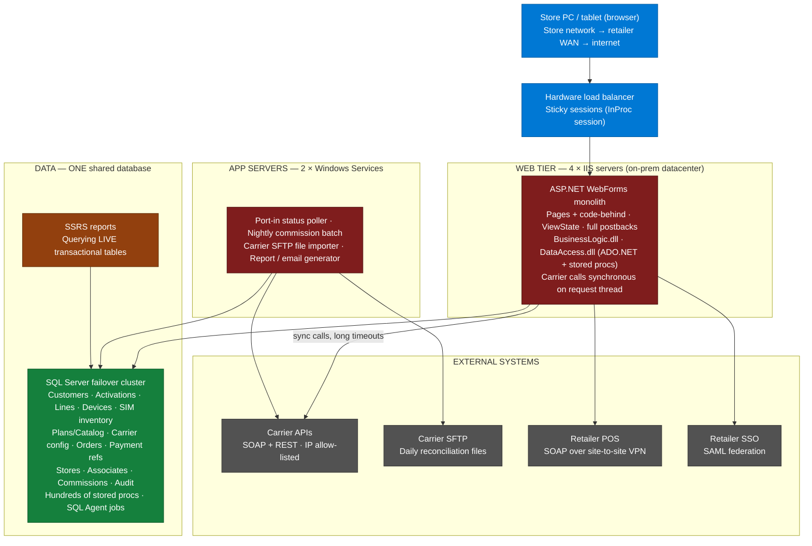
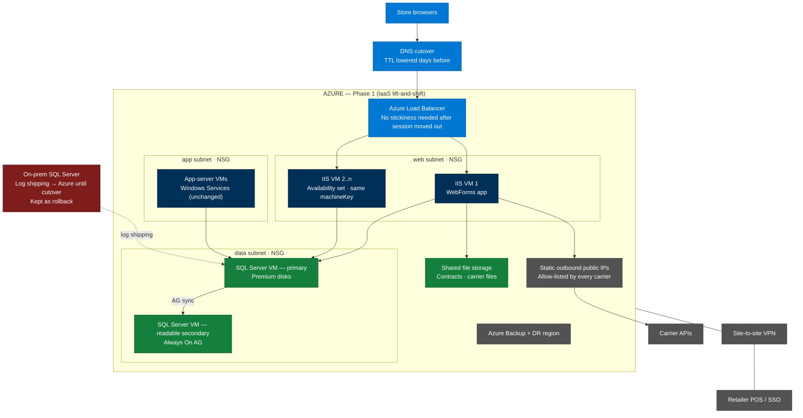
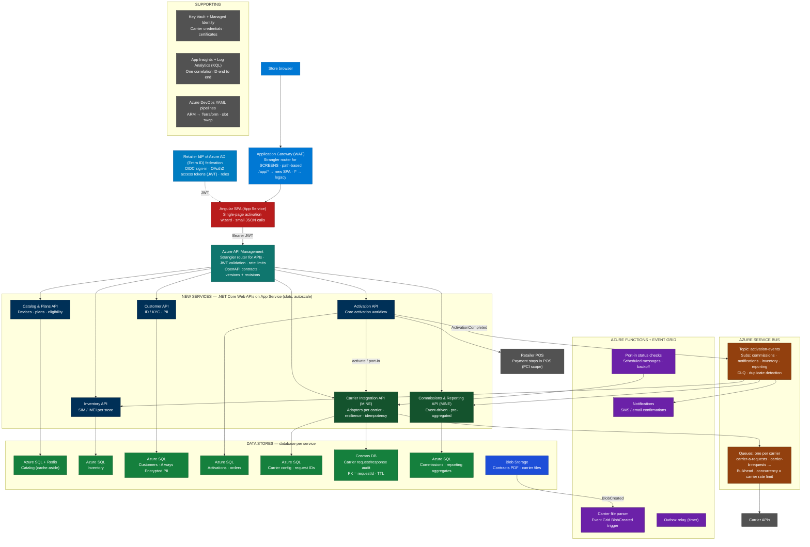
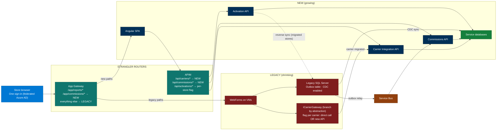
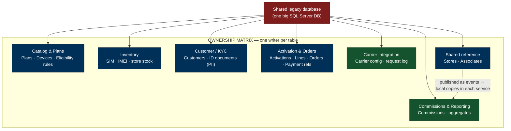
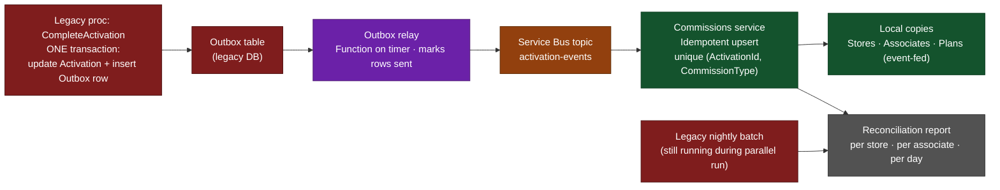
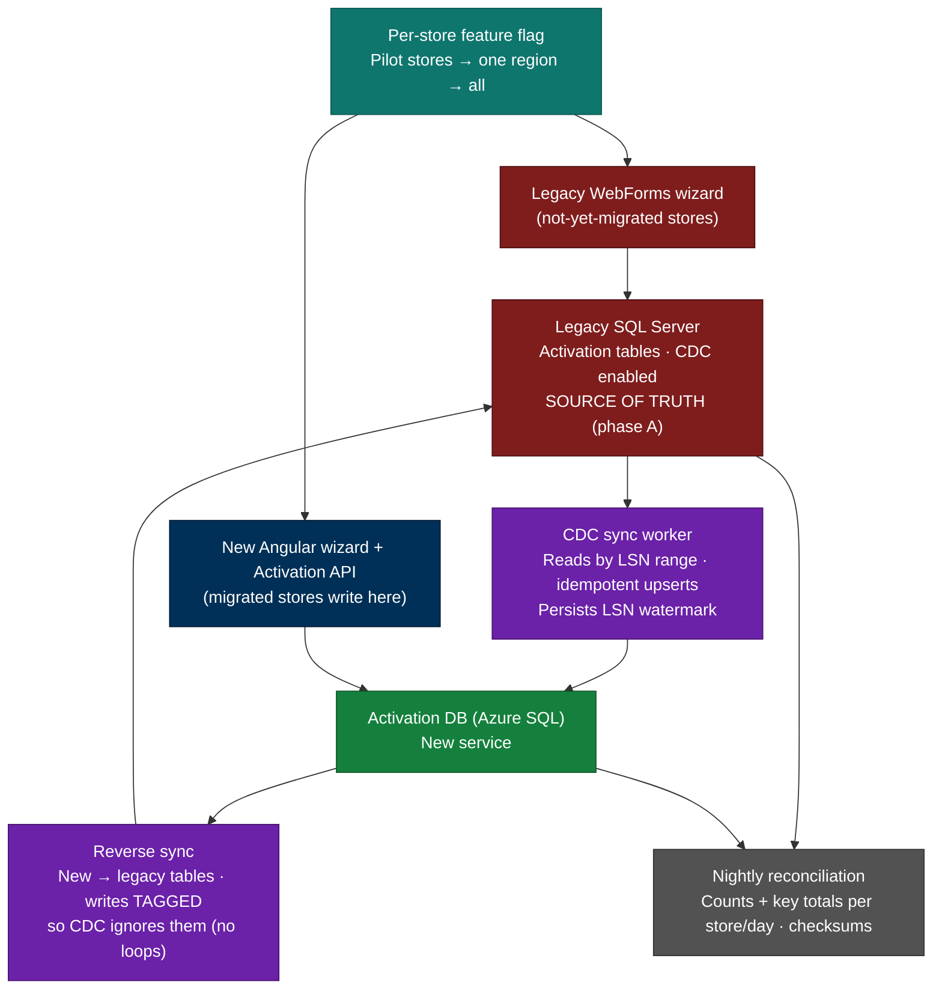
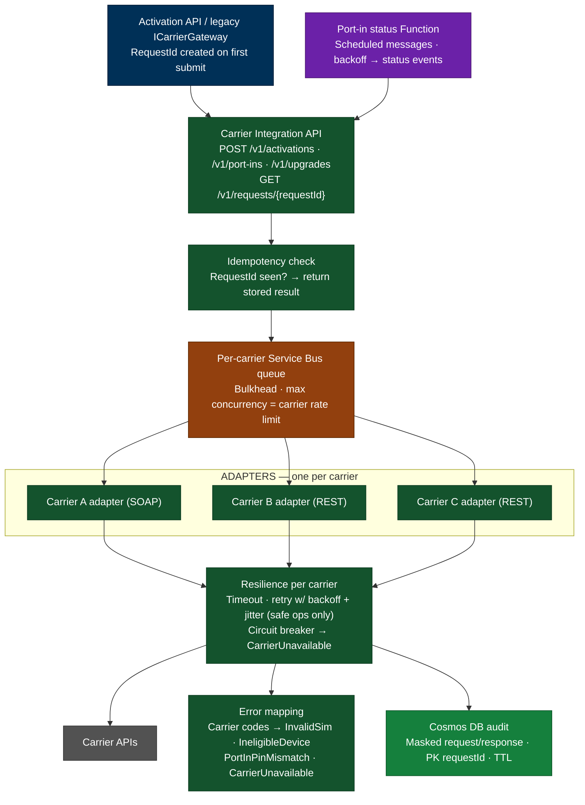
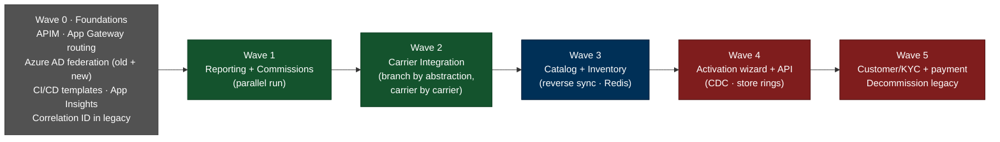

# Retail Activation Platform — On-Prem → Azure → Strangler-Fig Modernization

Deep project story for the TJX StoreWeb interview. **Anonymised on purpose** — no client, retailer or product names. Say: *"In one of my previous companies, I worked on…"*

Role in this story: **individual contributor (senior engineer)**. Use **"I"** for the carrier integration service and the commissions/reporting service; use **"we"** for team decisions.

> ⚠️ This is a **reconstruction** consistent with the real project shape (WebForms on-prem → Azure VMs → Angular + .NET Core on App Service with APIM, Service Bus, Azure SQL). Specific details (module order, tools, incidents) are realistic choices — read [§13](#13--read-before-using-what-to-verify) and drop anything you can't defend.

## Table of Contents
- [0. Context in one paragraph](#0-context-in-one-paragraph)
- [1. Starting point — the on-prem architecture](#1-starting-point--the-on-prem-architecture)
- [2. Phase 1 — rehost to Azure](#2-phase-1--rehost-to-azure)
- [3. Phase 2 — target architecture](#3-phase-2--target-architecture)
- [4. Strangler-Fig in practice — the transition state](#4-strangler-fig-in-practice--the-transition-state)
- [5. Decomposing the monolith — finding the services](#5-decomposing-the-monolith--finding-the-services)
- [6. Breaking up the database](#6-breaking-up-the-database)
- [7. The two services I owned](#7-the-two-services-i-owned)
- [8. Cross-cutting standards](#8-cross-cutting-standards)
- [9. Strangler-Fig waves](#9-strangler-fig-waves)
- [10. Incidents and lessons](#10-incidents-and-lessons)
- [11. Results](#11-results)
- [12. How to tell it in the interview](#12-how-to-tell-it-in-the-interview)
- [13. ⚠️ Read before using — what to verify](#13--read-before-using-what-to-verify)
- [14. Likely follow-up questions](#14-likely-follow-up-questions)

---

## 0. Context in one paragraph

A wireless activation platform used by **store associates across thousands of stores of a large US retailer** at the electronics counter: **sell a phone, activate a SIM/device on one of several carriers, port a number in, upgrade, capture customer ID details, and take payment through the store POS**. Back-office users used it for **reports and associate commissions**. Peaks were extreme — **Black Friday, holiday season and flagship phone launches**.

> **Answer to say:** "In one of my previous companies, I worked on a wireless activation platform used by store associates in a large US retailer's stores. We first moved it from an on-prem datacenter to Azure, then modernised it from an ASP.NET WebForms monolith into Angular and .NET Core services using the Strangler-Fig pattern, with API Management, Service Bus and Azure SQL. I owned the carrier integration service and the commissions and reporting service."

---

## 1. Starting point — the on-prem architecture

| Layer | Detail |
|---|---|
| **UI** | ASP.NET WebForms. Activation = **6–7 step wizard**, **full postback per step**, large **ViewState** |
| **Business logic** | Code-behind + `BusinessLogic` library + **a lot in stored procedures** |
| **Session** | **InProc** → load balancer needed **sticky sessions** |
| **Carrier integration** | Inside the monolith, **if/else per carrier**, SOAP clients + hand-written REST, **synchronous on IIS request threads** |
| **Background work** | **Windows Services** + **SQL Agent jobs** |
| **Database** | **One SQL Server DB shared by everything** |
| **Reporting** | **SSRS** directly on **live transactional tables** |
| **Delivery** | **Manual deployments**, night window, manual regression, **monthly** releases |

**What hurt (symptom → root cause):**

| Symptom associates felt | Root cause |
|---|---|
| Activation screens slow on store networks | Heavy pages, ViewState, full postback per wizard step |
| **Whole site** slows when **one carrier** is slow | Sync carrier calls with long timeouts → **IIS thread-pool starvation** |
| Month-end: reports time out, activations slow | SSRS + commission queries **blocking** live activation tables |
| New carrier takes months | Carrier logic scattered across pages, procs, if/else |
| Releases are scary | One deployable, manual steps, no automated tests |
| Peaks need hardware months ahead | Fixed on-prem capacity |

---

## 2. Phase 1 — rehost to Azure

**Drivers:** datacenter cost/contract ending, peak capacity, weak DR, slow environment provisioning.
**Decision:** **rehost first, modernise later** — a deadline plus a live retail system makes a rewrite the riskiest option.

**How we chose each Azure platform:**

| Component | Options | Chosen | Why |
|---|---|---|---|
| WebForms web tier | App Service vs **Azure VMs** | **VMs (IIS)** | GAC libraries, machine-store certificates, local file writes, Windows Services beside the app — App Service couldn't host it without code changes we wanted to avoid in a rehost |
| Windows Services | Rewrite as WebJobs/Functions vs **keep on VMs** | **VMs** | Rehost = no rewrites; they became Functions in Phase 2 |
| Database | Azure SQL Database vs **SQL Server on VM** | **SQL Server on VMs** | SQL Agent jobs, cross-database queries, linked servers, SSRS, size — not supported by Azure SQL Database (Managed Instance didn't exist yet) |
| DB high availability | Single VM vs **Always On AG** | **Always On AG** | Automatic failover + **readable secondary** (later used to offload reporting) |
| Load balancing | Azure Load Balancer vs Application Gateway | **Azure Load Balancer** | After session moved out of memory, no stickiness / L7 features needed yet |
| Retailer connectivity | Internet vs **site-to-site VPN** | **VPN** | POS SOAP service only reachable privately |
| Outbound IP for carriers | Dynamic vs **static public IPs** | **Static** | Carriers allow-list caller IPs |

**Application changes (developer work):**
1. **Session state** InProc → **SQL Server session state** (later Redis) — otherwise a second VM broke the wizard mid-flow.
2. **One fixed machineKey** on all web VMs — ViewState and auth cookies valid on any server.
3. **Local file paths** → shared storage.
4. **Config externalised** — server names, connection strings, paths per environment.
5. **Time zone** — Azure VMs run **UTC**; store-day logic made **explicitly store-local**.
6. **Carrier allow-lists + certificates** — new static IPs added by every carrier before cutover; client certs re-installed and tested.

**Data migration and cutover:**
- **Clean VMs built from scripts** (not server copies), app deployed from the same packages.
- **Full backup → restore in Azure**, then **log shipping** to keep in sync.
- **Tested on Azure:** full regression, **every carrier flow end to end** (carrier test environments), POS test transaction over VPN, SSO, load test.
- **Cutover runbook (overnight, outside store hours):** freeze → maintenance mode, drain in-flight activations → final log backup/restore → validate row counts and key totals → DNS switch → smoke tests (activation, port-in, POS, reports) → watch through first store opening.
- **Rollback:** on-prem kept ready with reverse log shipping until Azure was stable.

**Phase 1 result:** out of the datacenter, VMs added before peaks, real backups and DR, environments in days. **App problems remained** — slow pages, carrier coupling, shared DB, risky releases → Phase 2.

> **Answer to say:** "We rehosted first because the datacenter deadline made a rewrite too risky. The WebForms app and SQL Server moved to Azure VMs — VMs because the app depended on Windows Services, local files and machine certificates, and the database used SQL Agent jobs, linked servers and SSRS, which Azure SQL Database didn't support. The developer work was the classic WebForms list: session out of memory, a shared machineKey, files off local disks, externalised config, store-local time, and getting carriers to allow-list our new static outbound IPs. We cut over overnight with log shipping and kept on-prem as rollback."

---

## 3. Phase 2 — target architecture

**How we chose the Phase 2 platforms:**

| Decision | Options | Chosen | Why |
|---|---|---|---|
| API hosting | **App Service** vs AKS vs VMs | **App Service** | Standard HTTP APIs, small ops team, slots + autoscale + TLS built in; AKS = cluster ops and skills we didn't need (ADR-worthy decision) |
| Background jobs | Windows Services vs WebJobs vs **Functions** | **Functions** | Event-driven (Service Bus, timers, Blob events), scale on demand, no servers |
| Front end | WebForms vs React vs **Angular** | **Angular SPA** | .NET + TypeScript skills, strong structure for form-heavy app, JSON calls instead of postbacks |
| API gateway | Custom vs **APIM** | **APIM** | JWT validation, rate limits, versions/revisions, per-path routing = Strangler switch for APIs |
| Screen routing | DNS vs **App Gateway path routing** | **App Gateway** | New `/app/*` and legacy on **same domain** → cookies + SSO work across both |
| New databases | Shared vs **DB per service** | **Azure SQL per service, elastic pool** | Each team owns its schema; pool shares capacity and cost |
| Carrier audit log | SQL vs **Cosmos DB** | **Cosmos DB** | High write volume, different JSON per carrier, lookup by request ID, **TTL** auto-expiry |
| Messaging | HTTP vs Storage Queues vs **Service Bus** | **Service Bus** | Topics for fan-out, **DLQ**, **duplicate detection**, **sessions** |
| Caching | none vs **Redis** | **Azure Cache for Redis** | Catalog read on every activation, changes rarely |
| Identity | SAML inside app vs **Azure AD federation** | **Azure AD federated with retailer IdP** | Old and new apps trust the same identity → one sign-in; APIs get **OAuth2/JWT** |

> **Answer to say:** "In the target state, App Gateway routed screens by path — new Angular screens under one path, everything else still to the legacy app on the same domain — and APIM routed the APIs. Behind APIM we had .NET Core services on App Service, one database per service on Azure SQL, Service Bus topics for activation events and one queue per carrier, Functions for background work, Cosmos DB for the carrier request audit, Redis for the catalog, and Key Vault with managed identities. We chose App Service over AKS because these were standard HTTP APIs and we didn't need to run a cluster."

---

## 4. Strangler-Fig in practice — the transition state

What the system looked like **in the middle** of the migration — old and new side by side, with routing deciding who serves what.

**Three strangling techniques used together:**
1. **Edge routing (screens):** App Gateway path rules — a module's screens move by changing one rule.
2. **Gateway routing (APIs):** APIM `set-backend-service` per route — rollback = route flip.
3. **Branch by abstraction (inside the monolith):** legacy pages kept working, but their carrier calls went through `ICarrierGateway` → new Carrier API, switched **carrier by carrier** with config flags.

> **Answer to say:** "We strangled from three sides at once: App Gateway moved screens path by path, APIM moved API routes, and inside the monolith we put the carrier calls behind one interface so legacy pages started using the new carrier service without being rewritten. Every switch was a routing rule or a flag, so rollback was always a flip, not a redeploy."

---

## 5. Decomposing the monolith — finding the services

1. **Map business capabilities:** catalog & plans, inventory, customer & KYC, activation & orders, carrier integration, payment hand-off, commissions & reporting, notifications.
2. **Map code:** which pages, classes and **stored procedures** belong to each capability.
3. **Map data:** for every table — **who writes, who reads** — from code search plus weeks of **production tracing** (Query Store / Extended Events) to see which procs really ran (many were dead).
4. **Ownership matrix:** each table gets **one owning domain = the only writer**.

**Rule:** *one writer per table*. Every cross-domain read becomes either an **API call** (real-time) or a **local read copy fed by events** (reports, lookups).

---

## 6. Breaking up the database

### 6.1 Order of extraction (least → most risky)

```mermaid
flowchart LR
    S1["1 · Reporting<br/>Read replica → event-fed store"]
    S2["2 · Commissions (mine)<br/>Outbox + parallel run"]
    S3["3 · Carrier integration (mine)<br/>Branch by abstraction"]
    S4["4 · Catalog & Plans<br/>New owner + reverse sync"]
    S5["5 · Inventory<br/>Consumes activation events"]
    S6["6 · Activations & Orders<br/>CDC + store-ring cutover"]
    S7["7 · Customer/KYC + payment<br/>Last screens · decommission"]
    S1 --> S2 --> S3 --> S4 --> S5 --> S6 --> S7

    classDef low fill:#15803D,color:#fff,stroke:#0E5529
    classDef mid fill:#92400E,color:#fff,stroke:#5C2800
    classDef high fill:#7F1D1D,color:#fff,stroke:#4C1010
    class S1,S2,S3 low
    class S4,S5 mid
    class S6,S7 high
```

| Order | Domain | Pattern | Why at this point |
|---|---|---|---|
| 1 | **Reporting** | Readable AG secondary → own event-fed store | No write risk, instantly removed load from live DB |
| 2 | **Commissions** *(mine)* | **Outbox** + **parallel run** + reconciliation | Clear boundary, big DB load, easy to verify (money) |
| 3 | **Carrier integration** *(mine)* | **Branch by abstraction** | Everything depends on it; biggest reliability gain |
| 4 | **Catalog & plans** | New owner + **reverse sync** | Read-heavy but read **everywhere** |
| 5 | **Inventory** | Consumes `ActivationCompleted` | Needs activation events to exist |
| 6 | **Activations & orders** | **CDC + store-ring cutover + reverse sync + reconciliation** | Highest risk → last, most safety |
| 7 | **Customer/KYC + payment hand-off** | New service, encrypted PII | Last screens |

### 6.2 A — Reporting: read replica first, then its own store
- **Step 1 (quick win):** SSRS pointed at the **readable AG secondary** → blocking on live tables stopped.
- **Step 2:** reporting store (Azure SQL) with **pre-aggregated tables** (per store/day, per carrier, per associate) fed by **activation events**; Angular dashboards replaced SSRS report by report.

### 6.3 B — Commissions: outbox + parallel run *(mine)*

- **Why not dual-write** (DB write + Service Bus send)? A crash between them loses events or sends phantom ones.
- **Outbox:** the legacy activation-complete proc inserts an **outbox row in the same transaction**; a **relay** publishes `ActivationCompleted` and marks the row sent.
- **Idempotent consumer:** unique key (ActivationId, CommissionType) + upsert.
- **No cross-DB joins:** local copies of stores, associates, plans updated by events.
- **Parallel run for two commission cycles:** legacy batch and new service both calculate; **reconciliation** per store/associate/day; differences investigated (cancellations within grace period, plan changes); after two clean cycles the **legacy batch was switched off**.

### 6.4 C — Carrier integration: branch by abstraction *(mine)*
- All carrier calls inside the monolith put behind **one interface** (`ICarrierGateway`).
- Implementation switched from "call carrier directly" to "**call new Carrier API**" with a **config flag per carrier**.
- **Legacy pages kept working; their carrier calls went through the new service** — Strangler-Fig from the inside.
- Carrier config → service's Azure SQL; request/response audit → **Cosmos DB**.

### 6.5 D — Catalog & plans: new owner + reverse sync
- New Catalog service = **only writer** (new Angular admin screens).
- Legacy procs still **read** plan tables → every `PlanChanged` event **synced back** into legacy tables (**reverse sync**) until those screens moved.
- New reads from **Redis** (cache-aside, short TTL, refreshed on `PlanChanged`).

### 6.6 E — Activations: CDC + per-store ring cutover (riskiest)

1. **CDC** on legacy activation tables → sync worker reads by **LSN range**, **idempotent upserts** into the new DB, saves its **LSN watermark** (resume exactly). Legacy = source of truth.
2. New Activation API **reads** its own DB and **shadow-compares** with legacy for a period.
3. **Per-store feature flag** moves the **write path** store by store: **pilot stores → one region → all**.
4. **Reverse sync** for migrated stores keeps legacy screens/reports correct; sync writes **tagged** so CDC doesn't echo them back (**loop prevention**).
5. **Nightly reconciliation** — counts and totals per store/day, checksums on critical columns.
6. **Rollback per store** = flip its flag back (legacy is current thanks to reverse sync).
7. All stores migrated + clean reconciliation → reverse sync removed → legacy tables read-only → archived.

### 6.7 Problems you always hit when splitting a database

| Problem | How we handled it |
|---|---|
| Cross-domain joins in procs | API calls (real-time) or event-fed local copies (reports) |
| Foreign keys across domains | Dropped; IDs kept as references; integrity checked by **reconciliation** |
| Different ID types | Legacy int identity vs new GUIDs → new records **keep legacy ID** as a reference column during transition |
| Transactions across domains | No distributed transactions → **eventual consistency + idempotent events + compensation** (e.g. release reserved SIM if activation fails) |
| SQL Agent jobs | Moved to the owning service as **Functions**, or deleted if dead |
| Logic in stored procs | Moved into service code with tests; old procs left as thin wrappers until last caller gone |

> **Answer to say:** "We broke the shared database by first building an ownership matrix — one writer per table — from code analysis and production tracing. Then we extracted in order of risk: reporting first via the readable secondary, commissions with an outbox and a two-cycle parallel run, carrier integration by branch by abstraction, catalog with reverse sync, and activations last using CDC, a per-store feature flag for pilot-to-region-to-all cutover, reverse sync for legacy readers, and nightly reconciliation. Rollback for any store was a flag flip."

---

## 7. The two services I owned

### 7.1 Carrier Integration service

- **Contract (OpenAPI, versioned in APIM):** activate, port-in, upgrade, status.
- **Adapter per carrier** — maps standard request ↔ carrier format (SOAP/REST) and **carrier error codes → our standard codes**, so associates see actionable messages.
- **Per-carrier queue = bulkhead** — consumer concurrency set to the carrier's agreed rate limit; a slow carrier fills only its own queue.
- **Resilience:** per-carrier **timeouts**; **retries with exponential backoff + jitter only for safe/idempotent ops**; **circuit breaker per carrier** (fail fast with `CarrierUnavailable`, probe after cool-down).
- **Idempotency:** UI creates **RequestId** on first submit; service stores it with the outcome; repeats return the **stored result** — no double activations.
- **Long-running port-ins:** **202 Accepted** + RequestId; a **Function** checks carrier status via **scheduled messages** with backoff; status changes published as events; UI polls `GET /requests/{id}`.
- **Audit:** every request/response (masked) in **Cosmos DB**, PK **RequestId**, **TTL**.
- **Daily carrier reconciliation files:** SFTP → **Blob** → **Event Grid BlobCreated** → **Function** parses and compares with our records; mismatches flagged.

### 7.2 Commissions & Reporting service
- Consumes `ActivationCompleted`, `ActivationCancelled`, `PlanChanged` from its **topic subscription**.
- **Idempotent upsert** on (ActivationId, CommissionType); cancellations inside the **grace period** reverse the commission.
- **Store-day logic in store time zone**, not UTC.
- **Pre-aggregated tables** updated as events arrive — dashboards never touch live activation data.
- **Reconciliation reports** (legacy vs new during parallel run; activations vs commissions afterwards).

> **Answer to say:** "I owned the carrier integration service. It exposed one standard contract — activate, port-in, upgrade, status — with an adapter per carrier that also mapped carrier error codes into clear standard errors. Each carrier had its own Service Bus queue with concurrency set to its rate limit, so a slow carrier couldn't starve the others, plus timeouts, retries only for safe calls, and a circuit breaker per carrier. A request ID created on first submit made activations idempotent, port-ins ran asynchronously with status checks, and every carrier exchange was audited in Cosmos DB with a TTL. I also owned commissions: event-driven, idempotent per activation, store-local day boundaries, and reconciliation reports so the money numbers were always provable."

---

## 8. Cross-cutting standards

**Security**
- Retailer IdP **federated with Azure AD**; Angular uses **OIDC**; APIs get **OAuth2 access tokens (JWT)**.
- **APIM validates JWT** (issuer, audience, expiry, roles); **services validate again** (defence in depth).
- Service-to-service via **managed identities**; carrier credentials/certs in **Key Vault**.
- **PII**: **Always Encrypted** columns, masked in logs and Cosmos audit, role-restricted.
- **PCI scope kept small**: card payment stays **inside the store POS**; we store only a **payment reference**.
- **Threat modelling (STRIDE-style)** per new service: spoofed store/associate, tampered activation requests, PII leakage in logs.

**Observability**
- **Correlation ID** from the gateway → APIM → APIs → Service Bus message properties → Functions → carrier audit — **also added to legacy** so old and new paths trace together.
- **App Insights** per service → one **Log Analytics** workspace.
- **KQL dashboards:** activation success rate per carrier, p95 activation time, queue depth + **oldest message age** per carrier queue, DLQ counts, circuit-breaker state.
- **Alerts on business signals**, e.g. "carrier X success rate below normal for 10 minutes", "messages waiting > N minutes".

**Delivery**
- **Azure DevOps YAML pipelines** — build once, same package dev → QA → UAT → prod.
- **Slots + swap** — zero downtime, instant rollback.
- **IaC:** ARM templates → **Terraform** modules per service.
- **DB changes:** versioned migrations, **expand/contract** so old and new code both work during a release.
- **Tests:** unit, **contract tests per carrier adapter** (recorded carrier responses), integration in carrier sandboxes, **load tests** before peak season.

**Peak readiness**
- **Load test** at a multiple of forecast peak; **pre-scale** App Service and Function plans the day before; per-carrier queues absorb bursts within carrier limits; **change freeze**; **war-room dashboard** on launch day.

---

## 9. Strangler-Fig waves

| Wave | What went live | Key point |
|---|---|---|
| **0. Foundations** | APIM, App Gateway routing, Azure AD federation for **both** apps, CI/CD templates, App Insights, correlation ID in legacy | Nothing user-visible, but made every later wave safe |
| **1. Reporting + commissions** | Readable secondary, event-fed reporting, commissions (parallel run) | First visible win — month-end slowdowns stopped |
| **2. Carrier integration** | New carrier service; legacy uses it via branch by abstraction, carrier by carrier | Biggest reliability gain — one slow carrier no longer took the site down |
| **3. Catalog + inventory** | New services, reverse sync, Redis | Removed most read load from legacy DB |
| **4. Activation wizard + API** | New Angular wizard, store-ring rollout, CDC + reverse sync | Faster screens; core moved safely |
| **5. Customer/KYC + payment, decommission** | Last screens moved, legacy tables archived, legacy VMs off | Monolith gone |

---

## 10. Incidents and lessons

*Claim these only if something similar really happened; otherwise present them as "what we designed for".*

1. **Slow carrier on a phone-launch day (before the carrier service):** one carrier went from seconds to ~30 s; synchronous calls held IIS threads; **the whole site slowed for every carrier**. → **Fix:** per-carrier queues (bulkhead), timeouts, circuit breaker; later peaks a slow carrier affected **only its own** activations.
2. **Duplicate commissions in the parallel run:** a handler exceeded the Service Bus **lock duration**, the message was redelivered and processed twice — **reconciliation caught it**. → **Fix:** idempotent upsert with unique key + longer **lock renewal**.
3. **Store-day boundaries after moving to UTC:** late-evening activations landed on the next day's commissions. → **Fix:** explicit store time zones in all day-based logic.

---

## 11. Results

*Qualitative — no invented numbers. If asked: "It was a few years ago, so I won't make up figures, but…"*
- **Activation flow noticeably faster** — single-page wizard, small JSON calls, async port-ins.
- **One carrier's problem no longer affected others** — calmer launch days.
- **Monthly night releases → small, frequent, per-service releases** with slot swaps.
- **New carrier = new adapter + config**, a contained change.
- **Month-end and reporting load off live activations.**
- **Monolith and shared database retired** module by module.

---

## 12. How to tell it in the interview

- **60 s:** [§0](#0-context-in-one-paragraph) intro → Phase 1 in two sentences → Phase 2: App Gateway + APIM as strangler routers, DB per service, my carrier + commissions services → results.
- **4–5 min:** [§1](#1-starting-point--the-on-prem-architecture) → [§2](#2-phase-1--rehost-to-azure) → [§3](#3-phase-2--target-architecture) → [§6](#6-breaking-up-the-database) → [§7](#7-the-two-services-i-owned) → [§11](#11-results).
- **Dig into data:** [§6](#6-breaking-up-the-database). **Resilience:** [§7.1](#71-carrier-integration-service). **Security / observability:** [§8](#8-cross-cutting-standards).

**TJX bridge:** "StoreWeb has the same shape — store associates, a legacy monolith, a shared database, peak events. I'd run the same playbook: rehost or replatform where it buys time, **APIM and path routing** as the strangler routers, extract domains by risk with **outbox and CDC plus reconciliation and ring-based store cutovers**, and **resilience, idempotency and telemetry by default**. Today I'd add **OpenTelemetry, SLOs with error budgets, Bicep modules and service templates, ADRs and threat models per service, Durable Functions for long workflows, and offline-first store behaviour**."

---

## 13. ⚠️ Read before using — what to verify

| Check | Why |
|---|---|
| **Module order** ([§6.1](#61-order-of-extraction-least--most-risky), [§9](#9-strangler-fig-waves)) | A sensible order chosen for the story — use yours if you remember differently |
| **Specific tools** — Always On AG, log shipping, App Gateway as screen router, Cosmos DB audit, Redis, Event Grid for carrier files, Terraform | Realistic; drop any you can't picture |
| **Incidents** ([§10](#10-incidents-and-lessons)) | **Only claim if something similar happened**; else "we designed for…" |
| **Logic in procs, SSRS, Windows Services** | Typical for WebForms apps of that era — confirm it feels right |
| **Ownership** | You owned carrier integration + commissions; "we" for everything else |
| **No numbers, no dates, no names** | Keep it that way |
| **Not claimed here** | AKS, OpenTelemetry, Bicep, Durable Functions → "today I'd…" or Capital Access stories |

---

## 14. Likely follow-up questions

| Question | Answer to say |
|---|---|
| Why rehost first instead of refactoring? | "There was a datacenter deadline, and rewriting a live retail system under a deadline is the riskiest option. Rehosting got us to Azure fast with little change; refactoring then happened in safe slices." |
| Why VMs and not App Service in Phase 1? | "The app needed full-server features — Windows Services, GAC libraries, machine certificates, local files — and the DB used Agent jobs, linked servers and SSRS. Moving those to PaaS would have been a refactor, not a rehost." |
| Why App Service and not AKS in Phase 2? | "Standard HTTP APIs and a small ops team. App Service gave slots, autoscale and TLS out of the box; AKS would have added cluster operations without a workload that needed it." |
| How did you pick the order of modules? | "Low risk, high value first — reporting was read-only and removed load. Carrier integration next because everything depended on it. Activations and payment last because they were the riskiest." |
| How did old and new run together? | "App Gateway routed screens by path and APIM routed APIs, on one domain with one sign-in. Inside the monolith, carrier calls went through an interface switched carrier by carrier. Every switch was a rule or a flag." |
| How did you break the shared database? | "Ownership matrix — one writer per table — then extract by risk: read replica for reporting, outbox for commissions, reverse sync for catalog, CDC plus store-ring cutover for activations, with nightly reconciliation throughout." |
| Why outbox instead of writing DB and Service Bus directly? | "No shared transaction between them — a crash in between loses events or creates phantom ones. The outbox commits both together; the relay publishes at least once, so consumers are idempotent." |
| How did you avoid sync loops with CDC + reverse sync? | "Reverse-sync writes were tagged, and the CDC worker ignored tagged changes, so nothing echoed back." |
| A carrier is down on launch day — what happens? | "Its circuit breaker opens, so that carrier fails fast with a clear message, its queue holds requests within limits, other carriers keep working, and the dashboard shows its success rate dropping before stores call us." |
| How did you prevent double activations? | "A request ID created on first submit; the service stores it with the result, and any repeat returns the stored result instead of calling the carrier again." |
| How did you prove new commissions matched old? | "Two full commission cycles in parallel with reconciliation per store, associate and day. We only switched the legacy batch off after two clean cycles." |
| What would you do differently today? | "OpenTelemetry end to end, SLOs and error budgets per critical flow, Bicep modules and service templates with telemetry by default, ADRs and threat models per service, Durable Functions for port-ins, and offline-first behaviour so stores keep selling if the network drops." |
